<h1 align="center">Hey  I'm Thanmai</h1>

## 📌 About Me
- 💡 <em>Founder & CEO at Monolith · AI Systems Architect & Full-Stack Engineer building autonomous agents and enterprise platforms.</em>

## 📊 GitHub Stats & Activity

  
  

  

  

## 🛠️ Languages & Tools

> ## Programming Languages

     

> ## Frontend

     

> ## Backend

 

> ## Database

    

> ## DevOps & Cloud

     

> ## Tools

     

## 🔗 Connect with Me

 

<picture>
  <source media="(prefers-color-scheme: dark)" srcset="https://raw.githubusercontent.com/posathanmai1-lang/posathanmai1-lang/output/github-snake-dark.svg" />
  <source media="(prefers-color-scheme: light)" srcset="https://raw.githubusercontent.com/posathanmai1-lang/posathanmai1-lang/output/github-snake.svg" />
  
</picture>
